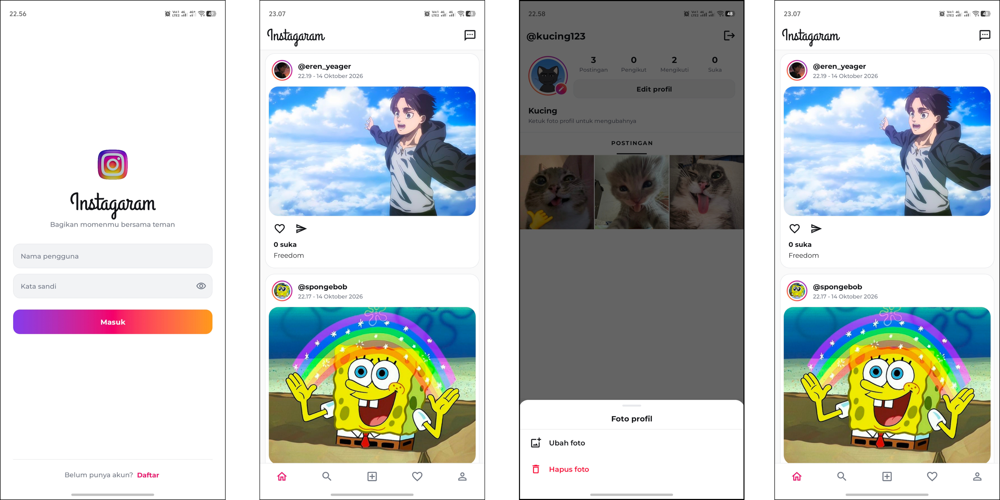
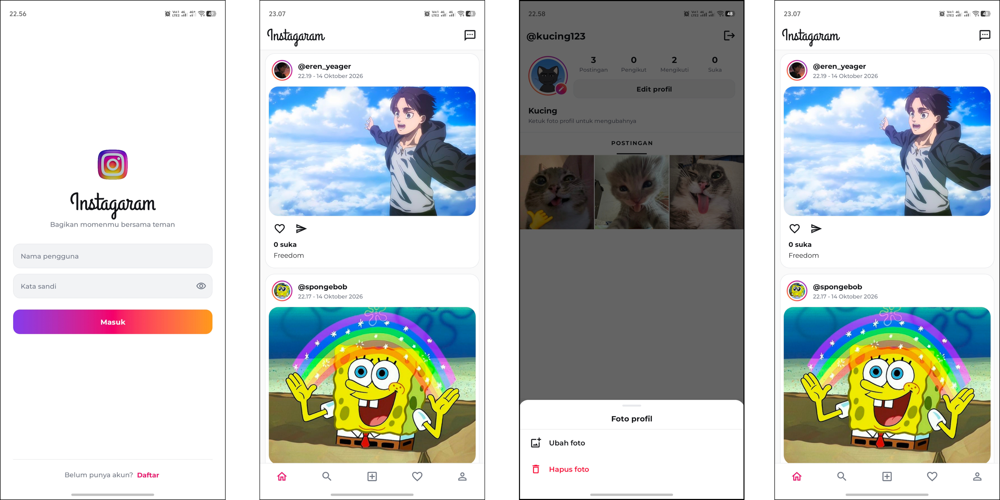
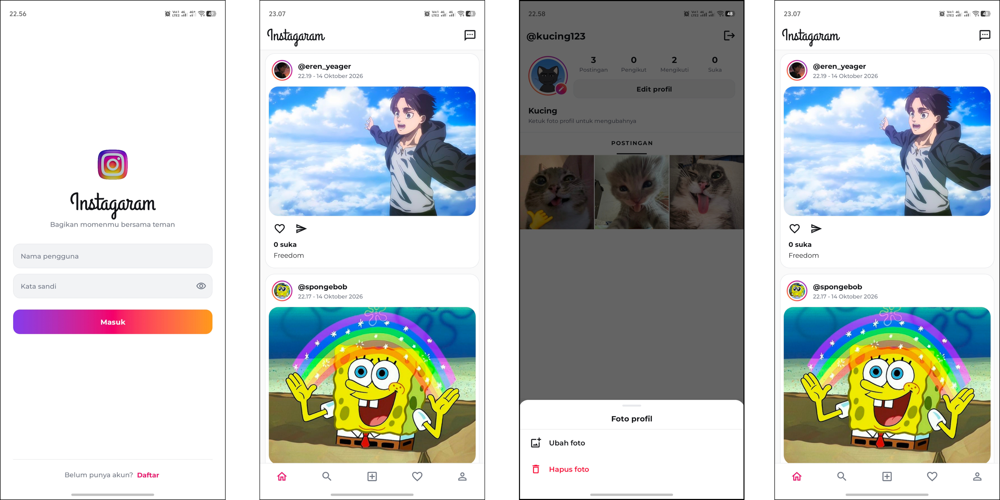
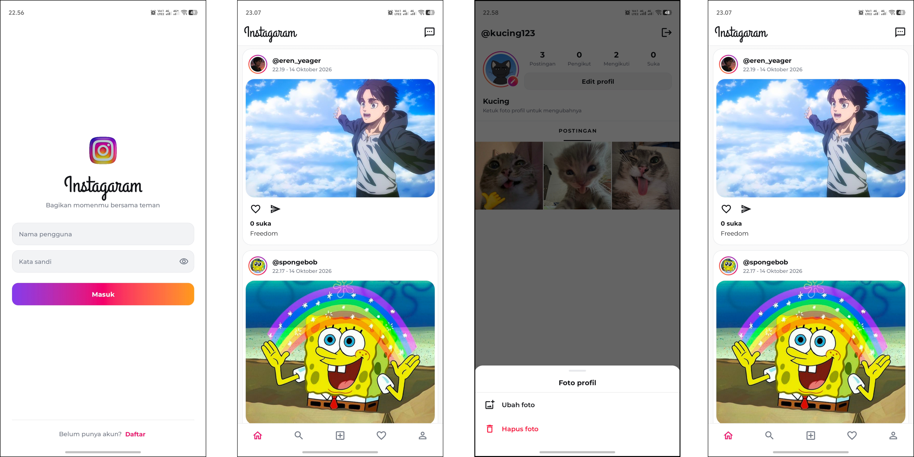
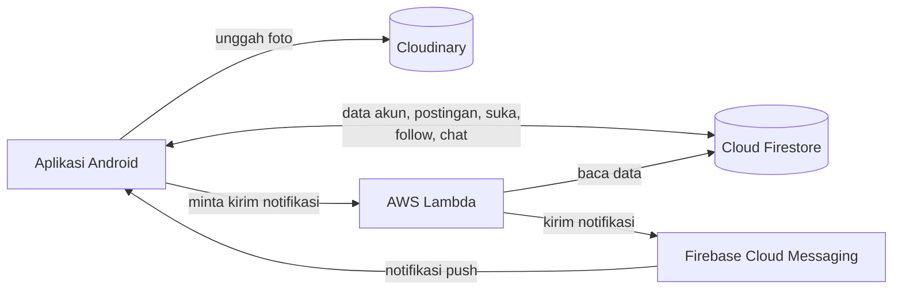

# Instagaram

Aplikasi media sosial Android bergaya Instagram untuk berbagi foto, mengikuti akun lain, menyukai postingan, mengobrol lewat pesan langsung, dan menerima notifikasi push.

Tersedia dalam **Bahasa Indonesia** dan **Inggris** (mengikuti bahasa perangkat), mendukung **mode gelap**, dan berjalan di **Android 7.0 ke atas**.

---

## Fitur

### Akun
- Daftar akun dengan username, nama, dan kata sandi; foto profil opsional
- Masuk dengan username dan kata sandi (kata sandi disimpan sebagai hash bcrypt)
- Edit profil (username dan nama)
- Ganti kata sandi dengan verifikasi kata sandi lama
- Ganti atau hapus foto profil
- Keluar dengan konfirmasi

### Beranda
- Feed postingan dari akun yang diikuti, terbaru di atas
- Dimuat bertahap saat menggulir (pagination)
- Suka / batal suka dan jumlah suka
- Bagikan foto ke aplikasi lain
- Akses cepat ke Pesan Langsung

### Postingan
- Unggah foto dari galeri dengan caption (maks. 50 MB, dikompres otomatis)
- Detail postingan
- Daftar akun yang menyukai postingan
- Hapus postingan sendiri

### Profil
- Statistik: jumlah postingan, pengikut, mengikuti, dan total suka
- Grid postingan
- Daftar pengikut dan mengikuti
- Profil akun lain dengan tombol Ikuti / Mengikuti dan Pesan

### Pencarian
- Cari akun berdasarkan username

### Aktivitas
- "xxx Menyukai Postingan Anda" lengkap dengan thumbnail postingan
- "xxx Mulai Mengikuti Anda"
- Foto profil dan waktu di setiap baris; ketuk untuk membuka profil atau postingan

### Pesan Langsung
- Daftar percakapan dengan pesan terakhir, diperbarui real-time
- Mulai percakapan dengan akun yang diikuti
- Chat real-time dengan pemisah tanggal dan status Online
- Hapus pesan untuk semua orang (maks. 24 jam setelah dikirim)

### Notifikasi Push
- Pesan baru, suka baru, dan pengikut baru
- Ketuk notifikasi untuk langsung membuka chat, postingan, atau profil terkait
- Kanal terpisah (Chat, Suka, Pengikut) yang bisa diatur masing-masing di pengaturan Android

---

## Tech Stack

| Bagian | Teknologi |
|---|---|
| Aplikasi | Java, XML Layout, ViewBinding, Material Components |
| Database | Cloud Firestore |
| Penyimpanan foto | Cloudinary |
| Notifikasi | Firebase Cloud Messaging |
| Server notifikasi | AWS Lambda (Node.js) |
| Library | Glide, jBCrypt, CircleImageView, RoundedImageView |

---

## Arsitektur

- **Aplikasi Android** membaca dan menulis data langsung ke **Cloud Firestore**, termasuk pembaruan real-time untuk chat.
- **Foto** dikompres di perangkat, diunggah ke **Cloudinary**, dan hanya tautannya yang disimpan di Firestore.
- **Notifikasi** dikirim oleh **AWS Lambda** lewat **Firebase Cloud Messaging**, sehingga kunci server tidak pernah berada di aplikasi.